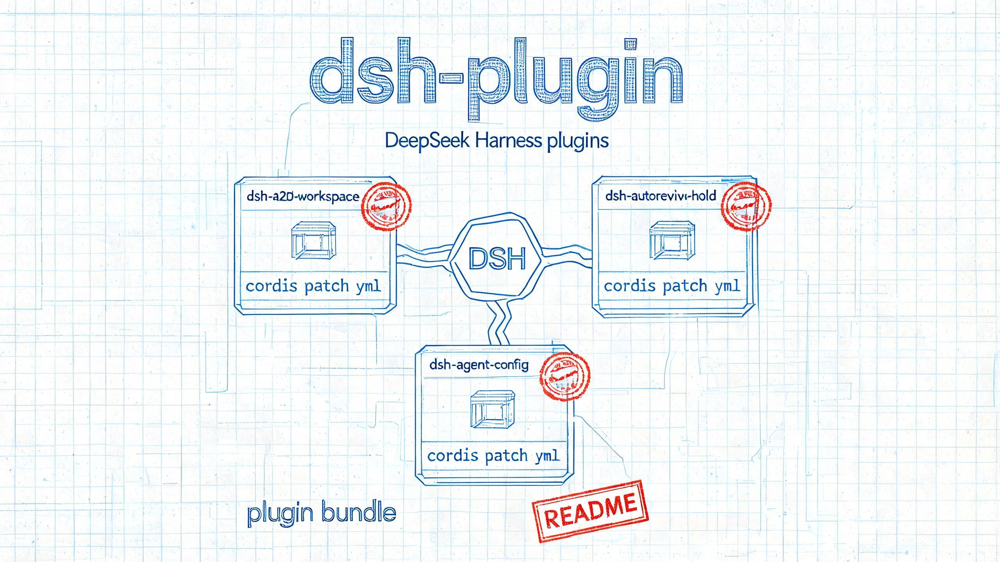

<div align="center">

# dsh-plugin

**个人自用的 DeepSeek Harness 插件汇总**

写给自己用的 DSH 小插件，顺手放在这里。<br />
_A personal collection of plugins for [DeepSeek Harness](https://github.com/deepseek-ai/deepseek-harness)._

[](./LICENSE)
[](https://github.com/topics/dsh-plugin)
[](https://github.com/Arthur244/dsh-plugin)

</div>



## 这是什么

[DeepSeek Harness](https://github.com/deepseek-ai/deepseek-harness)（简称 **DSH**）是一个“一切皆插件”的 agent harness。这个仓库是我的个人插件收纳箱：平时自己写、自己用的小插件都放这里，换机器时好找，也方便改着玩。

不追求大而全，**不对可用性做任何保证，欢迎借鉴创意**。公开出来，只是万一某个想法刚好对你有用——代码随意取用。

> 本仓库不是 DeepSeek 官方项目，与官方无隶属关系。

## 收录原则

- **自用优先**：先解决自己的真实问题，再考虑通用性。
- **一个插件一个目录**：仓库根下独立目录、独立 manifest，可单独安装和卸载。
- **源码可读**：不加密、不混淆，方便自己改，也方便别人抄。
- **随缘维护**：DSH 还在 developer preview，接口会变，插件可能失效或重构。

## 插件清单

| 插件 | 一句话说明 | 安装 profile | 状态 |
| :--- | :--- | :---: | :---: |
| [`dsh-a2d-workspace`](./dsh-a2d-workspace) | 把外部 ACP 客户端（Zed 等）产生的会话按 `cwd` 自动归入桌面端「工作区」，在会话侧栏按目录名分组 | desktop | ✅ 可用 |
| [`dsh-autorevivw-hold`](./dsh-autorevivw-hold) | 在「设置 → 通用 → 权限」的默认权限模式中加入「自动审查（实验）」，切换时弹风险确认并可勾选不再提示 | desktop | ✅ 可用 |
| [`dsh-agent-config`](./dsh-agent-config) | 统一管理技能 / 子代理 / 规则三类配置：来源分组、搜索、详情、逐项启停 | —— | 🚧 设计草案 |

- **`dsh-a2d-workspace`**（0.1.0）：解决「Zed 里开的会话在桌面端全都堆在 Ungrouped」的问题。启动时、每次 `session/created`、以及每 30s 定时扫描，把没有归属的根会话按 cwd 挂进（或新建）对应工作区；幂等，不会覆盖你改过名的工作区标题。详见 [插件 README](./dsh-a2d-workspace/README.md)。
- **`dsh-autorevivw-hold`**（0.2.0）：在权限设置行追加「自动审查」选项（仅当 Host 的 Auto 集成可用时出现），同时启用官方 `@deepseek-ai/dsh-experimental-auto-review`。选择后由 Host 在新会话创建时应用 Auto，风险确认可勾选「以后不再显示」并持久记忆。详见 [插件 README](./dsh-autorevivw-hold/README.md)。
- **`dsh-agent-config`**（未实现）：目前只有 [设计草案](./dsh-agent-config/doc/design.md)，尚未落地代码。方向是把 `dsh-skills-manager` 那套「来源分组 + 开关 + 详情」的信息架构扩展到规则和子代理，并区分全局 / 工作区两个作用域。

每个插件的安装命令、配置项和已知问题，以插件目录下的 README（或 `doc/`）为准。

## 文档

| 文档 | 内容 |
| :--- | :--- |
| [`docs/installed-third-party-plugins.md`](./docs/installed-third-party-plugins.md) | 本机 `desktop` profile 已装三方插件的一次性盘点（版本、启用状态、孤儿包、可升级项）与复核命令 |
| [`docs/ds-create.md`](./docs/ds-create.md) | DSH Agent 配置与「创造模式」开发指南（结论核对过 `ref/deepseek-harness` 源码） |
| [`docs/gemini-create.md`](./docs/gemini-create.md) | 同主题指南：Cordis 微内核、Agent 预设体系与创造模式扩展 |
| [`docs/cc-create.md`](./docs/cc-create.md) | 同主题指南：模式即预设、Agent 配置体系与创造模式运行逻辑 |
| [`submodule.md`](./submodule.md) | `ref/` 下 submodule（添加、拉取、更新、删除）的通用操作与踩坑记录 |

> 三份 `*-create.md` 是同一主题的不同版本，内容有重叠；要查结论以 `docs/ds-create.md` 为准（它标注了源码核对）。`docs/installed-third-party-plugins.md` 则是**某台机器在某个时间点的快照**，换机器或升级 DSH 后就会过期。

## 安装

需要先安装 DSH，并确保 `dsh` 命令可用（也可以使用 `npx @deepseek-ai/dsh`）。

profile 是 DSH 的一套配置，常见名字是 `web` / `acp` / `desktop`；不确定自己的 profile 名时，看 `~/.dsh/profiles/` 下的目录。**不同插件要求的 profile 不同**：需要工作区（Workspace）服务的插件只能装 `desktop`（底层即 web profile），装到 `acp` 里不会生效。

### 从包名安装

```sh
# 安装（profile 换成插件要求的那个）
dsh plugin --profile desktop add <插件包名>

# 固定版本（推荐）
dsh plugin --profile desktop add <插件包名>@0.1.0

# 更新 / 卸载
dsh plugin --profile desktop add <插件包名>@latest
dsh plugin --profile desktop remove <插件包名>
```

装完后按 DSH 的提示重启；Web 界面建议硬刷新（`Ctrl/Cmd + Shift + R`）。

> **装前看一眼版本。** DSH 处于 developer preview，插件与宿主版本强绑定。版本不匹配时 DSH 会拒绝安装，不要为了装上而强行跳过校验。升级 DSH 前，建议先备份 profile 目录（`~/.dsh/profiles/<name>`）。

### 从本地文件夹安装

适合安装本仓库里还没发布到 npm 的插件。目标文件夹必须是一个 DSH bundle：里面有 `package.json`，并且声明了 `dsh.bundle.patch`。否则 DSH 不会把它当作插件启用：命令行会按普通依赖安装并给出警告，Web 界面通常会直接拒绝。

**方式一：Web 界面**

1. 打开侧边栏的 **插件** 页（没有这个入口就改用下面的命令行）。
2. 点 **添加插件**；也可以点旁边的箭头，选 **安装第三方插件**。
3. 填入插件文件夹的**绝对路径**：
   - Windows：`E:\Code\dsh-plugin\dsh-a2d-workspace`
   - macOS / Linux：`/Users/you/code/dsh-plugin/dsh-a2d-workspace`
4. 点 **安装**。装完后按提示点 **立即启用**。

**方式二：命令行**

```sh
# 在仓库根目录，使用相对路径
dsh plugin --profile desktop add ./dsh-a2d-workspace

# Windows 绝对路径：用 link: 前缀 + 原生盘符路径（正斜杠）
dsh plugin --profile desktop add "link:E:/Code/dsh-plugin/dsh-a2d-workspace"

# macOS / Linux 绝对路径
dsh plugin --profile desktop add "/Users/you/code/dsh-plugin/dsh-a2d-workspace"
```

> **Windows 路径坑**：`link:` 后面必须写 `E:/...` 这种原生盘符路径。Git Bash 里的 `$PWD` 是 `/e/Code/...` 形式的 MSYS 路径，pnpm 会原样记进 `package.json` 和 lockfile，符号链接最终指向不存在的 `E:\e\Code\...`。

首次 `add` 若报 `cannot resolve profile bundle`，属于初始化时序问题（依赖已写入，bundle 清单与补丁合并落后一步），再跑一次即可：

```sh
dsh plugin --profile desktop install
```

安装完成后重启 DSH；Web 界面建议硬刷新。

**确认装上了：**

```sh
dsh --profile web --dump-config
```

输出里出现插件对应的层（类似 `# == dsh-a2d-workspace`）就说明已加入 profile；也可以在侧边栏 **插件** 页看到它，并确认开关已打开。

> `desktop` profile 例外：它由 Electron 独占管理，`dsh --profile desktop --dump-config` 会被直接拒绝。这种情况改用两步验证——`grep 插件名 ~/.dsh/profiles/desktop/package.json` 看 `dependencies` 与 `dsh.profile.bundles` 是否都有它，再重启应用靠实际行为验证。

> 本地目录是**链接安装**，不是拷贝。移动或删除源文件夹后插件会失效；改完代码通常要重启 DSH，TypeScript 插件还要先重新构建。

**常见问题**

- 装完在插件列表里找不到：检查 `package.json` 是否声明了 `dsh.bundle.patch`；没有声明时，命令行只会把它装成普通依赖。
- Web 界面提示找不到包或不是插件包：路径要指向插件文件夹本身，且里面有 `package.json` 和 `dsh.bundle.patch`。
- 插件装了但行为没变化：先确认 profile 对不对（工作区相关只能 desktop），再确认 `dsh.profile.bundles` 里确有该包。
- `remove` 后符号链接残留：`dsh plugin remove` 只改 `package.json` / lockfile，必要时手动 `rm -f ~/.dsh/profiles/desktop/node_modules/<插件名>`。
- 路径有空格：命令行里用引号包住整个路径。
- 版本不兼容：按提示改 `engines.dsh` 或换兼容的插件版本，不要跳过校验。

## 本地开发

每个插件都是一个标准的 DSH **bundle**：`package.json` 用 `dsh.bundle.patch` 指向一份 patch，由 patch 把插件行插进 profile。

最小结构：

```json
{
  "name": "dsh-example",
  "version": "0.1.0",
  "type": "module",
  "main": "index.js",
  "files": ["index.js", "cordis.patch.yml"],
  "dsh": { "bundle": { "patch": "./cordis.patch.yml" } },
  "engines": { "dsh": ">=0.2.1-rc.2 <0.3.0" }
}
```

`engines.dsh` 按插件实际验证过的 DSH 版本填写，不要直接照抄示例范围。

```yaml
# cordis.patch.yml
- insert:
    - id: example
      name: dsh-example
```

```js
// index.js
export const name = 'example'

export function apply(ctx) {
  // 在这里通过 ctx 注册工具、命令、事件或 UI
}
```

写好后，按上面的「从本地文件夹安装」把插件目录装进 profile；能用 `dsh --profile web --dump-config` 看到插件层，就说明配置已生效。

更完整的说明见官方文档：[第一个插件](https://github.com/deepseek-ai/deepseek-harness/blob/master/docs/user/develop/basic/index.zh.md)、[打包与安装插件](https://github.com/deepseek-ai/deepseek-harness/blob/master/docs/user/develop/basic/publish.zh.md)。

## 目录结构

```text
dsh-plugin/
├── dsh-a2d-workspace/        # 插件：ACP 会话自动归入桌面端工作区
│   ├── package.json
│   ├── cordis.patch.yml
│   ├── index.js              # Host 侧入口
│   ├── doc/                  # 开发与踩坑记录
│   └── README.md             # 安装、配置、已知问题
├── dsh-autorevivw-hold/      # 插件：默认权限模式加入「自动审查」
│   ├── package.json
│   ├── cordis.patch.yml
│   ├── index.js              # Host 侧入口（新会话应用 Auto）
│   ├── schema.js             # 插件配置 schema
│   ├── client.js             # Web UI 入口（重绘权限设置行）
│   ├── locale/               # 插件标题 / 描述（en / zh）
│   ├── icon.svg
│   └── README.md
├── dsh-agent-config/         # 设计中，目前只有 doc/design.md
│   ├── doc/design.md
│   └── README.md             # 状态与设计稿入口
├── docs/                     # 仓库级文档（环境盘点等）
├── asset/                    # 文档配图（README 图片统一放这里）
├── ref/                      # submodule：只读参考仓库（deepseek-harness 等）
├── test/                     # 本地试验目录（不入库）
├── submodule.md              # submodule 操作说明
├── .dsh/                     # 本机工作区级配置（已 gitignore，不提交）
├── LICENSE
└── README.md
```

不同插件按需增减 `client.js`、`schema.js`、`locale/`、`icon.svg` 等文件。`ref/` 下是 submodule，只作为参考，**不要**用 `dsh plugin add` 安装它们；相关操作见 [submodule.md](./submodule.md)。

## 兼容性

- DSH 目前是 **developer preview**，插件 API 和宿主行为都可能变。
- 每个插件用 `engines.dsh`（或 `@deepseek-ai/dsh-*` peer 依赖）声明支持的版本范围。
- 插件失效时，优先找兼容的新版本，而不是改宿主或跳过版本校验。
- 本仓库不承诺跨 DSH 版本可用。

## 交流

- 发现问题欢迎开 Issue，但不保证响应时间。
- 这个仓库以自用为主，PR 不一定合并；如果只是想借用代码，直接 fork 更省事。

## 免责声明

这是一个个人自用项目，按 **“现状”（AS IS）** 提供，不附带任何明示或暗示的担保。

插件可能会修改 DSH 的行为、读写本地文件或调用外部服务。**请在了解代码后再安装**；因使用本仓库造成的任何问题或损失，由使用者自行承担。

欢迎借鉴思路和代码。二次分发请保留 [LICENSE](./LICENSE)。

## 相关链接

- [DeepSeek Harness](https://github.com/deepseek-ai/deepseek-harness) — 官方仓库
- [DSH 文档](https://deepseek-harness.github.io/deepseek-harness/) — 官方文档
- [插件开发指南](https://github.com/deepseek-ai/deepseek-harness/blob/master/docs/user/develop/basic/index.zh.md) — 从第一个插件开始
- [GitHub `dsh-plugin` topic](https://github.com/topics/dsh-plugin) — 发现更多社区插件

## License

[MIT](./LICENSE) © 2026 [Arthur244](https://github.com/Arthur244)
