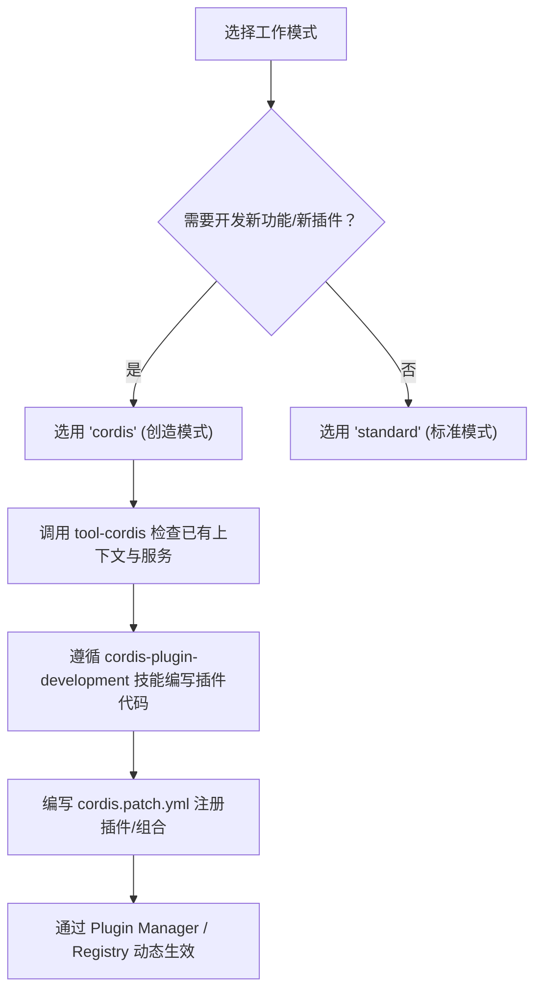

# DeepSeek Harness (DSH) Agent 开发与创造模式指南 (cc-create)

本文档旨在为面向 DeepSeek Harness (DSH) 的 Agent 开发与插件扩展提供架构指南，重点解析 Agent 配置体系、预设机制以及**创造模式（Creator Mode / `cordis`）**的运行逻辑与开发能力。

---

## 1. 核心概念：模式即预设 (Modes as Presets)

在 DSH 中，**没有独立的 `AgentMode` 枚举**。所有的“模式”都是通过 **Agent Preset（预设）** 体系实现的：
- 模式本质上是 Cordis 插件集合的声明式组合（包含 Tools、Persona、Prompt Sections、Skills 等）。
- 运行时通过 `ctx.agentPresets`（`AgentPresetRegistry`）进行注册、组合与解析。
- **锁定规则**：Session 在开始第一轮对话交互后，当前预设（模式）即被锁定，不允许中途切换。

### 1.1 内置四大模式

定义于 [`packages/preset/agent-preset-registry/src/display.ts`](file:///e:/Code/dsh-plugin/ref/deepseek-harness/packages/preset/agent-preset-registry/src/display.ts) 与各预设 patch 文件中：

| 预设 ID | 显示名称 (中/英) | 排序 | 核心特征与定位 | 配置文件路径 |
| :--- | :--- | :---: | :--- | :--- |
| `standard` | 标准模式 / Standard mode | 1 | 完备的编码与工程辅助工具集（Shell, FS, Plan, Workflows 等） | `packages/bundle/web-app/presets/standard.patch.yml` |
| `ptc` | PTC 模式 / PTC mode | 2 | 面向程序化工具调用（Programmatic Tool Calling）的精简/专用模式 | `packages/bundle/web-app/presets/ptc.patch.yml` |
| `minimal` | 极简模式 / Minimal mode | 3 | 轻量辅助问答，不注入完整工程运行环境，关闭 runtimeContext | `packages/bundle/web-app/presets/minimal.patch.yml` |
| `cordis` | **创造模式 / Creator mode** | 4 | **通过自然语言扩展 DSH**：内置插件开发 Skill、运行时检查工具及市场管理能力 | `packages/bundle/web-app/presets/cordis.patch.yml` |

---

## 2. Agent 配置与运行时体系

### 2.1 核心类型定义

#### 1. Agent 句柄 (`types.ts` & `runtime-types.ts`)
- **基础定义** ([`packages/core/agent/src/types.ts`](file:///e:/Code/dsh-plugin/ref/deepseek-harness/packages/core/agent/src/types.ts)):
  ```typescript
  export interface Agent {
    readonly id: SessionId
  }
  ```
- **运行时扩展** ([`packages/core/agent/src/runtime-types.ts`](file:///e:/Code/dsh-plugin/ref/deepseek-harness/packages/core/agent/src/runtime-types.ts)):
  ```typescript
  // 注入运行时 Context 的完整 Agent 属性
  readonly options: AgentOptions    // 模型路由回退与 token 限制
  readonly session: Session         // 对应的 Session 实例
  readonly model: Model             // 选定的 Model
  readonly inbox: Inbox             // 待处理任务队列
  readonly status: AgentStatus      // 'idle' | 'running'
  readonly ctx: Context             // Agent 绑定的 Cordis 上下文
  
  // 核心控制方法
  cancel(): void
  whenIdle(): Promise<void>
  runMaintenance(): Promise<void>
  send(event: SessionInputEvent): void
  followup(event: SessionInputEvent): void
  steer(event: SessionInputEvent): void
  inject(event: SessionEvent): void
  ```

#### 2. AgentOptions 与模型配置
```typescript
export interface AgentOptions {
  provider?: string                          // 模型服务商路由 (Adapter)
  model?: string                             // 具体的模型 ID
  reasoningEffort?: ReasoningEffortId        // 推理强度配置
  maxTokens?: number                         // 单次输出最大 Token 阈值
}
```
默认模型由 `@deepseek-ai/dsh-agent-default-model` 服务提供，默认配置为 `provider: deepseek-official`，`model: deepseek-flash`。

#### 3. Agent 创建参数 (`CreateAgentOptions`)
在创建 Agent 实例时，通过元数据绑定当前会话的预设：
```typescript
export interface CreateAgentOptions {
  sessionId: SessionId
  parentAgent?: Agent
  meta?: {
    cwd?: string
    parentSession?: SessionId
    isSeeded?: boolean
    origin?: string
    delegationDepth?: number
    agentPreset?: string   // 关键：指定使用的预设 ID (如 'standard', 'cordis')
  }
  agentOptions?: AgentOptions
  seed?: SessionEvent[]
  setup?: AgentSetup
}
```

---

## 3. 创造模式（Creator Mode / `cordis`）深度解析

创造模式的设计目标是：**“用对话定制 DSH：让 Agent 编写插件，添加新功能或界面；也能组合工具和提示词，创建自己的模式。”**

### 3.1 模式对比与功能矩阵

| 能力模块 | 标准模式 (`standard`) | 创造模式 (`cordis`) | 作用说明 |
| :--- | :---: | :---: | :--- |
| **基础工程工具** (Shell / FS / Web) | ✅ | ✅ | 代码阅读、文件读写、Bash/PowerShell 运行等 |
| **Plan 模式切换** (`@deepseek-ai/dsh-plan-mode`) | ✅ | ✅ | Session 级别的规划/执行状态切换 |
| **运行时检查工具** (`tool-cordis`) | ❌ | **✅ 启用** | 允许 Agent 查询 Cordis 运行时中的已挂载服务、配置与上下文 |
| **插件开发技能集** (`skills/`) | ❌ | **✅ 注入** | 自动向 Agent 上下文提供插件开发指导、脚手架与规范模板 |
| **插件市场工具** (`tool-plugin-market`) | 禁用 | **✅ 启用** | 检索与引用插件生态市场资源 |
| **插件管理工具** (`tool-plugin-manager`) | 条件启用 | **✅ 启用** | 动态安装、卸载、加载插件包与 Bundles |

### 3.2 创造模式注入的专属技能 (Skills)

创造模式通过 `cordis.patch.yml` 将 `@deepseek-ai/dsh-agent-preset/skills/` 注入给 Agent：
1. **`cordis-plugin-development`**：指导 Agent 编写合规的 Cordis 插件，包含标准脚手架、服务注册声明及 TypeScript 类型定义规范。
2. **`editing-cordis-compositions`**：指导 Agent 如何正确读写 `patch.yml` 与配置文件，修改组合配置而不破坏原有服务依赖。
3. **`cordis-composition-reference`**：内置 `packages.md`，提供官方已支持包、服务名、导出接口的清单与说明。
4. **`agent-experience`**：关于工具参数描述设计、上下文消费的官方最佳实践。

---

## 4. Persona 系统与 Plan Mode

### 4.1 Persona 插件机制 (`@deepseek-ai/dsh-persona`)
系统提示词由各预设中的 Persona 插件组织：
```typescript
interface PersonaConfig {
  prefix: string              // 系统提示词前缀
  suffix?: string             // 第一方指导后的附加提示
  complete?: boolean          // 为 true 时覆盖全量提示词，不再追加环境描述
  includeRuntimeContext?: boolean  // 是否自动附带运行时环境快照
}
```
- **Standard / PTC / Cordis**：
  - `prefix`: `"You are a coding agent powered by the {{model}} model."`
  - `includeRuntimeContext`: 开启，自动附带环境参数。
- **Minimal**：
  - `prefix`: `"You are a helpful software engineer assistant."`
  - `complete`: `true`（纯粹问答，隔离运行时环境）。

### 4.2 计划模式 (Plan Mode)
- **非独立预设**，而是会话内的状态切换器（通过 `@deepseek-ai/dsh-plan-mode` 实现）。
- 当开启 Plan Mode 时，系统会注入约束性 Prompt，要求 Agent 仅梳理操作步骤、评估风险，禁止直接调用高危执行动作。
- 完成规划后通过调用 `exit_plan_mode` 退出，恢复正常执行。

---

## 5. Agent 开发者实战指引

在基于 DSH 进行 Agent 或插件开发时，遵循以下开发流程：



### 5.1 创建自定义模式 (Custom Preset) 示例
若需要沉淀定制化的 Agent 模式，可定义新的 `PresetDefinition` 或提供对应的 patch 文件：
```yaml
# custom-preset.patch.yml
- id: custom-agent-preset
  name: '@deepseek-ai/dsh-agent-preset'
  config:
    id: my-custom-mode
    name: "我的定制模式"
    description: "专用于特定任务流的组合"
    order: 10
    plugins:
      - name: '@deepseek-ai/dsh-persona'
        config:
          prefix: "You are a specialized workflow specialist."
      - name: '@deepseek-ai/dsh-tool-shell'
      - name: '@deepseek-ai/dsh-tool-fs'
      # ...根据需求组合其他插件
```

### 5.2 开发注意事项
1. **生命周期锁定**：会话首轮对话一旦发生，`meta.agentPreset` 便无法改变。若要切换到创造模式开发插件，需启动新会话或重置会话。
2. **Cordis 服务依赖**：在开发新工具插件时，若需依赖环境信息，通过 `ctx.inject` 声明依赖（如 `ctx.agentPresets`, `ctx.systemPrompt` 等），避免隐式全局调用。
3. **安全与边界**：在创造模式下开发的插件若涉及 Shell/本地调用，建议配合 `tool-plan-mode` 或相应的权限拦截机制，确保操作可审计、可回滚。

