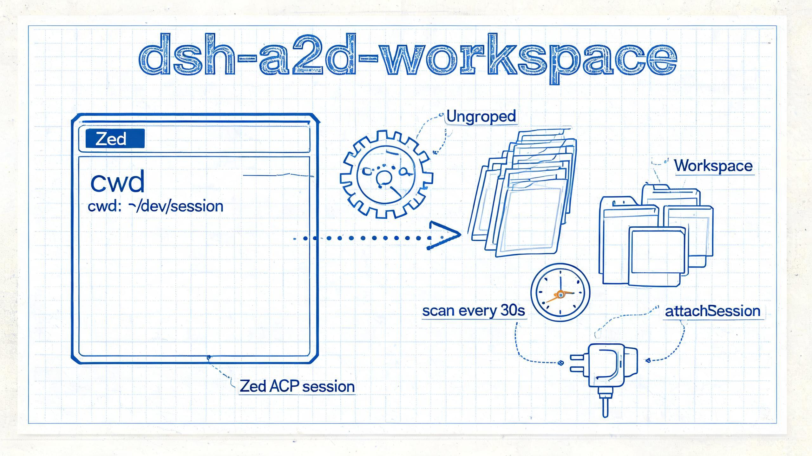

# dsh-a2d-workspace

把外部 ACP 客户端（Zed 等）产生的持久会话，按 `cwd` 自动归入桌面端的「工作区（Workspace）」，让它们在会话侧栏里按工作区名分组显示。

> 版本 `0.1.0` · 安装 profile **desktop**（Web 应用 / 桌面端）· 需要 `workspaceRegistry` + `sessionPersistence` 服务



## 解决什么问题

ACP profile 不挂载工作区服务，Zed 创建的会话虽然 header 里带 `cwd`，但在桌面端的 workspace 表里没有归属，只能落在 **Ungrouped**；桌面端自身的 workspace bootstrap 又只在首次启动时跑一次。本插件在桌面端监听并补上这层归组。

## 安装

```bash
# link 路径必须用原生盘符路径（C:/...），不要用 Git Bash 的 MSYS 路径（/c/...）
dsh plugin --profile desktop add "link:C:/path/to/dsh-a2d-workspace"

# 首次 add 后若报「cannot resolve profile bundle」，再跑一次：
dsh plugin --profile desktop install
```

安装后**重启桌面端**（DeepSeek Harness 应用 / 刷新当前 Web GUI）生效。

> 本地目录是链接安装，不是拷贝。移动或删除源文件夹插件即失效；改完代码需要重启 DSH。

## 验证

`desktop` profile 由 Electron 独占管理，`dsh --profile desktop --dump-config` 会被拒绝，只能换两条路验证：

```sh
# 1. 确认包与 bundle 都已写入 profile
grep dsh-a2d-workspace ~/.dsh/profiles/desktop/package.json   # dependencies + dsh.profile.bundles

# 2. 重启后在 Zed 里新开一个会话，回桌面端看它是否已进入以目录名命名的工作区
```

Web 版 profile 可用 `dsh --profile web --dump-config`，输出里出现 `# == dsh-a2d-workspace` 即配置生效。

## 配置项

| 配置 | 默认值 | 说明 |
| :--- | :--- | :--- |
| `intervalMs` | `30000` | 定时扫描间隔（毫秒），用于跨进程兜底拾取新会话 |

## 行为

- 启动时、每次 `session/created`、以及每 `intervalMs` 定时扫描一次；
- 只归组根会话（`origin !== 'subagent'` 且无 `parentSession`），无 `cwd` 或 `cwd` 不是绝对路径的会话跳过；
- 按 `cwd` 先 `resolveByPath` 找已有工作区，找不到才 `create`（标题取目录 basename）；
- `create` / `attachSession` 均幂等，不会覆盖已改名的工作区标题；单个会话失败只记 warn，不中断整轮扫描。

## 文件结构

```text
dsh-a2d-workspace/
├── package.json
├── cordis.patch.yml   # 插入 desktop profile，默认 intervalMs: 30000
├── index.js           # Host 侧实现（reconcile / 定时器）
├── doc/dsh-a2d-workspace.md  # 根因分析与完整开发记录
└── README.md
```

## 已知问题

- `sessionPersistence.list()` 每次扫描遍历全部持久会话，会话量极大时建议调大 `intervalMs`。
- 已归属的会话不会被移出或改属，插件只做「补齐无归属」这一件事。
- 未声明 `engines.dsh`，只通过 peer 依赖 `@deepseek-ai/cordis` 约束；DSH 升级后若服务名或方法签名变化，插件可能失效。

## 卸载

```bash
dsh plugin --profile desktop remove dsh-a2d-workspace
# 若残留符号链接：
rm -f ~/.dsh/profiles/desktop/node_modules/dsh-a2d-workspace
```

已归属的工作区记录会保留，不会丢会话。

## 更多

- 根因、API 依赖与逐段实现说明：[doc/dsh-a2d-workspace.md](./doc/dsh-a2d-workspace.md)
- 仓库总体安装说明：[../README.md](../README.md)
