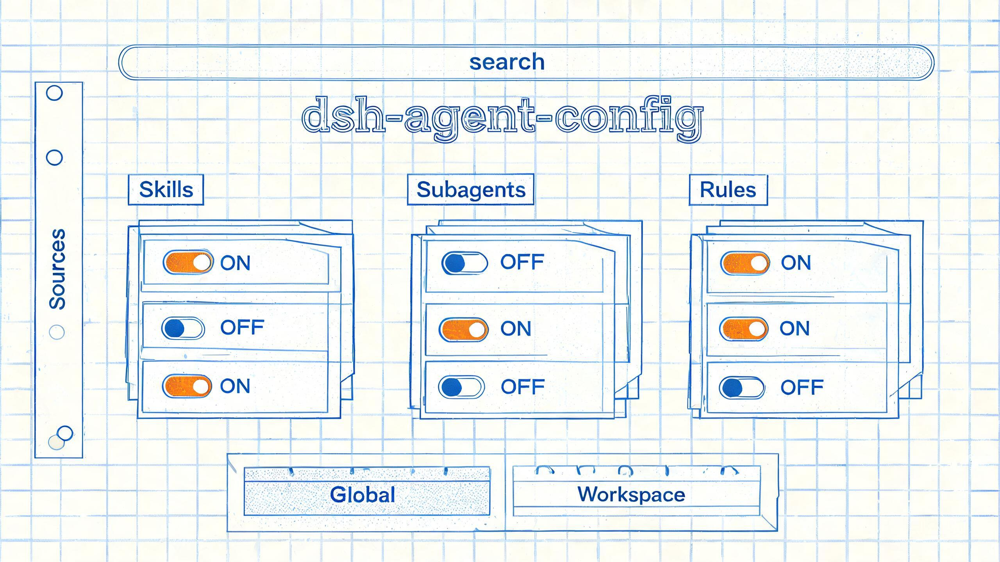

# dsh-agent-config

统一管理 DSH 的三类扩展资产——**技能（skill）/ 子代理（subagent）/ 规则（rule）**：按来源分组，支持搜索、查看详情、逐项启用/停用，并区分「全局」与「工作区」两个作用域。

> 状态：**设计草案，尚未实现**。目前本目录只有设计稿，没有可安装的代码。



## 现状

| 项目 | 内容 |
| :--- | :--- |
| 设计稿 | [`doc/design.md`](./doc/design.md)（v0.1，待评审） |
| 包名 / 显示名 | `dsh-agent-config` / 「Agent 配置」 |
| 能否安装 | 否，等设计稿确认 6 个决策点后进入实现 |
| 参考实现 | `dsh-skills-manager`、`dsh-agency-agents` |

## 设计要点

- **一个页面管三类资产**：技能、子代理、规则都能浏览、搜索、看详情、开关。
- **全局 / 工作区分层**：工作区配置只对该工作区生效，且优先于全局（同名冲突按设计稿 §5.4）。
- **默认目录零配置可用**：建议默认根目录为 `~/.dsh/agent-config/{skills,subagents,rules}`（设计稿 §13 Q3，待拍板）。
- **多来源**：可添加多个额外目录，可排序、停用、移除；移除来源不删除磁盘文件。
- **不改源文件即可启停**：开关只影响 DSH 的加载结果，不改、不移动来源里的文件。
- **状态持久**：来源、开关、界面偏好写入插件自己的状态目录，重启后保留。

非目标：不做技能市场 / 在线安装、不做云同步、不执行来源目录里的脚本、不替代 DSH 原生加载器。

## 目录

```text
dsh-agent-config/
├── README.md          # 本文件：状态与入口
└── doc/design.md      # 完整设计草案（背景、数据模型、交互、架构、MVP、验收）
```

## 相关

- 工作区级配置示例（本机、已 gitignore）：[`../.dsh/README.md`](../.dsh/README.md)
- 仓库总体说明：[`../README.md`](../README.md)
