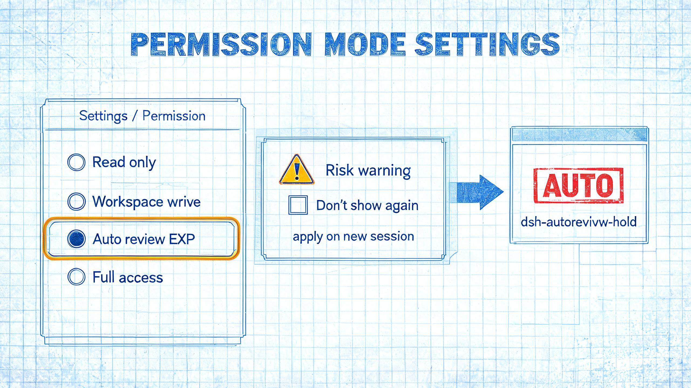

# dsh-autorevivw-hold

在 DeepSeek Harness Web **设置 → 通用 → 权限**的默认权限模式选择器中加入「自动审查」选项；切换到自动审查（或完全权限）时弹出风险确认，自动审查的确认框可勾选**「以后不再显示此风险提示」**并持久记忆。

> 版本 `0.2.0` · 安装 profile **desktop** · `engines.dsh`：`>=0.2.1-rc.3 <0.3.0`



## 安装

```bash
dsh plugin --profile desktop add ./dsh-autorevivw-hold
```

也可以在 Web 界面的 **插件 → 添加插件** 里填入插件文件夹的绝对路径。

插件会同时启用官方 `@deepseek-ai/dsh-experimental-auto-review` 集成（`cordis.patch.yml` 里把该行 `disabled` 置为 `false`），对话框下方的会话权限选择器也会恢复「自动审查」选项。安装后重启 DSH，Web 界面建议硬刷新。

## 工作方式

- 插件以同 id 阴影（`priority: -1`）替换官方权限设置行的渲染，把「自动审查（EXP）」追加进选项列表；仅当 Host 的 Auto 集成处于活动状态时显示。
- 选择「自动审查」会写入两条配置：官方 `permission.defaultPreset` 回落到当前的安全预设（通常是 `workspace-write`），插件配置 `defaultAutoReview=true` 由 Host 侧在**新会话创建时**应用 Auto（`session/created` 后经 `queueMicrotask` 执行，避免和官方初始 pin 抢时序）。
- 风险确认勾选「不再提示」后写入 `skipAutoReviewWarning=true`，之后直接切换、不再弹窗；取消勾选路径（选回普通预设）会重置该标记。
- 官方边界保持不变：`auto` 不是合法的 `defaultPreset` 值，因此本插件用自有命名空间存默认值。

## 配置

| 配置项 | 默认值 | 说明 |
| :--- | :---: | :--- |
| `defaultAutoReview` | `false` | 是否让新会话默认选择 Auto review |
| `skipAutoReviewWarning` | `false` | 是否跳过启用时的风险确认（由确认框的「不再提示」勾选写入） |

两个字段都标了 `volatile()`，因此会出现在设置服务的 `settings.describe` 里，可热改、无需重挂载。

## 验证

```sh
# 1. 确认包与 bundle 都已写入 profile
grep dsh-autorevivw-hold ~/.dsh/profiles/desktop/package.json

# 2. 重启后打开 设置 → 通用 → 权限，默认权限模式里应出现「自动审查」选项
```

`desktop` profile 由 Electron 独占管理，`dsh --profile desktop --dump-config` 会被拒绝；若装的是 Web profile，可改用 `dsh --profile web --dump-config` 看插件层。

## 文件结构

```text
dsh-autorevivw-hold/
├── package.json         # dsh.bundle.patch + dsh.client（web 入口与依赖注入）
├── cordis.patch.yml     # 启用官方 auto-review，并插入本插件（默认两项 false）
├── index.js             # Host 侧：新会话按 defaultAutoReview 应用 Auto
├── schema.js            # 配置 schema（Schemastery，volatile 字段）
├── client.js            # Web UI：阴影官方权限设置行 + 风险确认
├── locale/{zh,en}.json  # 插件标题 / 描述
├── icon.svg
└── README.md
```

## 已知问题

- Auto review 是实验功能，需要当前模型可用；它可能误放行或误拒绝操作，并会额外消耗模型请求。
- 关闭插件后，已创建的 Auto 会话由官方集成迁移到 Full access；设置行恢复为官方版本（不含自动审查选项）。
- 「不再提示」只作用于设置行的风险确认；会话内权限选择器的确认逻辑由官方代码控制，本插件不修改。
- 配置按新会话生效：修改 `defaultAutoReview` 不会回改已经存在的会话。
- 与宿主版本强绑定（`engines.dsh` 限定了 rc 区间），升级 DSH 后可能需要等插件适配。

## 卸载

```bash
dsh plugin --profile desktop remove dsh-autorevivw-hold
# 若残留符号链接：
rm -f ~/.dsh/profiles/desktop/node_modules/dsh-autorevivw-hold
```

卸载后官方 `dsh-experimental-auto-review` 的启用状态若不再需要，可在插件页手动关闭。

## 更多

- 仓库总体安装说明：[../README.md](../README.md)
